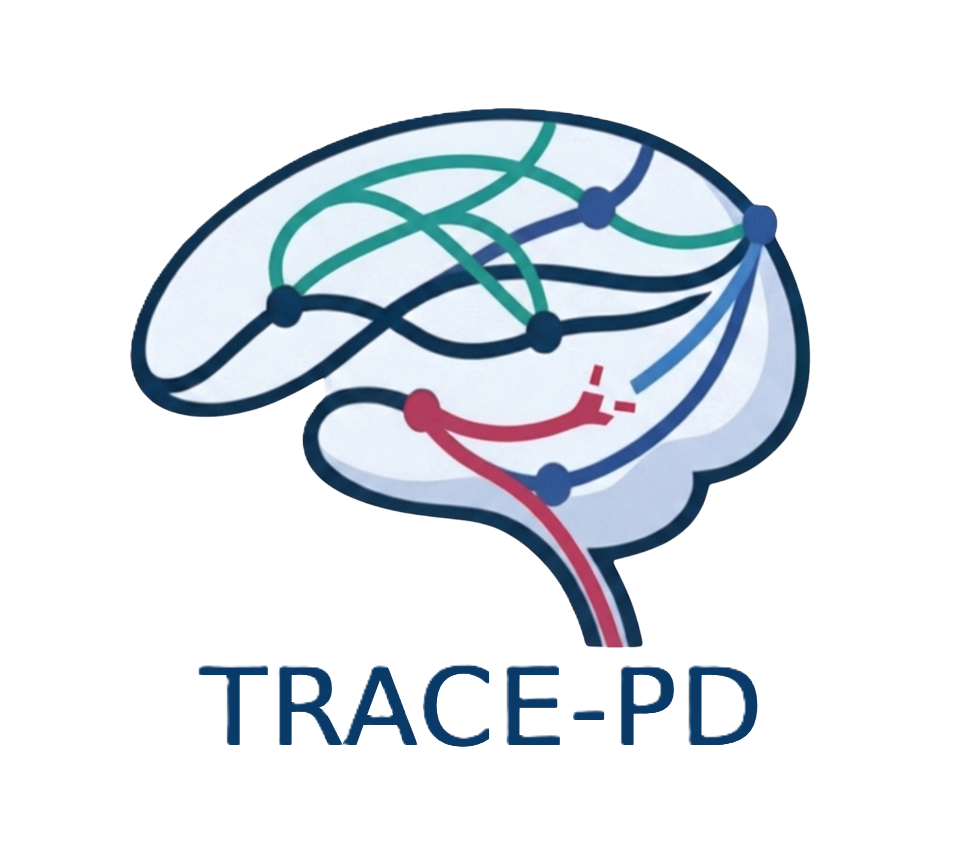
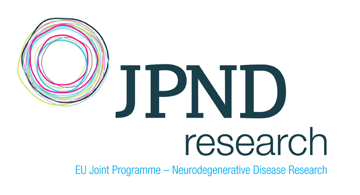

# TRACE-PD
TRACKING THE MECHANISMS OF DISEASE PROGRESSION AND FUNCTIONAL COMPENSATION IN THE EARLY PHASE OF PARKINSON’S DISEASE

**New approaches to early detection and therapy of Parkinson's disease**

[More information (University of Marburg)](https://www.uni-marburg.de/de/aktuelles/news/2025/tracepd-1)

## Coordinator

- **David Pedrosa**, Philipps-University Marburg, Germany

## Partners

- **Rick Helmich**, Radboud University Medical Center, Netherlands
- **Irena Rektorová**, Masaryk University, Czech Republic
- **Thilo van Eimeren**, University of Cologne, Germany
- **Josefine Waldthaler**, Karolinska Institutet, Sweden

## Publication

Marina C. Ruppert-Junck, Thilo van Eimeren, Kathrin Giehl, Rick C. Helmich, Merle Hönig, Martin E. Johansson, Kristína Mitterová, Irena Rektorová, Josefine Waldthaler, David J. Pedrosa, TRACE-PD consortium.
[Resilience mechanisms in Parkinson's disease: a domain-specific conceptual framework](https://doi.org/10.1093/brain/awag310). *Brain*, 2026, awag310.

## Working programs

- **Metabolic correlates of midbrain degeneration in early PD and across early disease span**
  Philipps-University Marburg, Germany
- **Developing a resting-state MRI-based biomarker of cortical compensation in PD**
  Donders Institute, Radboud University Medical Centre, Nijmegen, Netherlands
- **Functional correlates of acute and chronic treatment response in early PD**
  Karolinska Institutet, Stockholm, Sweden
- **Cognitive reserve in early-stage PD and MCI-LB using multimodal longitudinal imaging**
  Central European Institute of Technology, Masaryk University, Brno, Czech Republic
- **Domain- and hemisphere-specific cerebral resilience factors in PD**
  University Hospital Cologne, Germany

## Contact persons

- Prof. Dr. David Pedrosa
- Ms. Dr. rer. nat. Marina Ruppert-Junck
- Ms. Anneke Below

Tel.: 06421 58 65299
Email: [david.pedrosa@uni-marburg.de](mailto:david.pedrosa@uni-marburg.de)
Email: [marina.ruppert@uni-marburg.de](mailto:marina.ruppert@uni-marburg.de)

## Supported by

